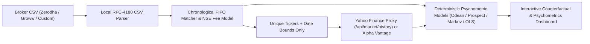

# ArthaMetric — Behavioral Finance & Trade Psychometrics

[](https://react.dev/)
[](https://www.typescriptlang.org/)
[](https://tailwindcss.com/)
[](https://vitest.dev/)
[](#privacy-architecture)

**ArthaMetric** is a privacy-first, purely mathematical behavioral finance analyzer built for Indian retail equity traders (**Zerodha Kite**, **Groww**, and custom broker CSV exports). Instead of generic P&L summaries or AI chatbots, ArthaMetric computes deterministic econometric diagnostics directly in your browser and benchmarks your behavior against historical NSE/BSE share prices from **Yahoo Finance** and **Alpha Vantage**.

---

## Key Mathematical Models

1. **Chronological FIFO Matching & Indian Statutory Friction**
   - Matches partial and full fills across long and intraday short legs in strict FIFO order.
   - Estimates realistic NSE/BSE statutory drag (STT, Exchange Transaction Charges, SEBI Turnover Fee, Stamp Duty, 18% GST, and capped intraday brokerage).
2. **Disposition Effect — Odean (1998) `PGR / PLR` & Two-Proportion Z-Test**
   - Reconstructs open inventory on every realized exit date and marks concurrent positions against real historical daily closing prices to measure **Paper Gains** vs **Paper Losses**.
   - Outputs `PGR`, `PLR`, `Disposition Spread (PGR − PLR)`, `Z-score`, `p-value`, and Holding Duration Asymmetry (`H_loss / H_win`).
3. **Kahneman–Tversky Prospect Theory Value Function**
   - Calibrates curvature parameters ($\alpha, \beta$) and implied loss aversion coefficient ($\lambda$) from realized return distributions and tail asymmetry.
4. **Post-Loss Revenge Trading (2-State Markov Chain)**
   - Quantifies conditional win-rate decay $P(\text{Win}_t \mid \text{Loss}_{t-1})$ vs $P(\text{Win}_t \mid \text{Win}_{t-1})$, inter-trade time compression, and post-loss position-size escalation.
5. **Overtrading OLS Regression & Disciplined Counterfactual Attribution**
   - Regresses daily trade frequency against session return % ($\beta_1, R^2$) and simulates a disciplined counterfactual equity curve alongside a **Nifty 50 (`^NSEI`)** equal-notional benchmark.

---

## System Architecture



### Privacy Architecture

- **Zero CSV Uploads**: Your raw tradebook CSV, quantities, prices, and P&L never leave browser memory.
- **Ticker-Only Market Queries**: Only deduplicated stock symbols and date spans are queried to retrieve public daily OHLC bars.
- **No Unsolicited AI**: All diagnostics are 100% deterministic mathematical formulas—zero LLM hallucinations.

---

## Local Setup & Scripts

```bash
# Install dependencies
npm install --legacy-peer-deps

# Start local dev server (Express Yahoo Finance proxy + Vite SPA on port 3000)
npm run dev

# Run automated unit & integration tests (Vitest + React Testing Library)
npm test -- --run

# Type-check and build production static bundle
npm run lint
npm run build
```

---

## GitHub Pages Deployment

The included `.github/workflows/deploy.yml` workflow builds the static SPA using Node 22 (`npm install --legacy-peer-deps`) and deploys `dist/` to GitHub Pages on every push to `main`. In static browser deployments without the Express proxy, users can optionally enter a free Alpha Vantage API key inside **Market Context** (stored strictly in browser `localStorage`).
